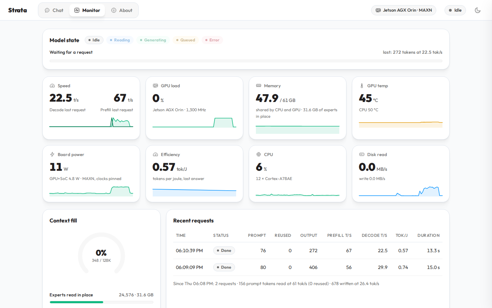

# Strata for NVIDIA Jetson (RNP)

RNP's port of [Strata](https://github.com/Niko1221/Strata) to the NVIDIA Jetson AGX Orin and other 64-bit Arm boards
whose GPU shares the RAM. It runs [Qwen3.8-Flash-Next](https://huggingface.co/Qwen/Qwen3.8-Flash-Next), a
125-billion-parameter mixture-of-experts model, on the board, with an OpenAI- and Anthropic-compatible API and a chat
page.

Branch `jetson-arm64`, based on Strata 0.2.2 (engine 0.1.47). For desktop GPUs, Windows and Mac, use
[the original project](https://github.com/Niko1221/Strata#readme).

## What this fork adds

- **Arm64 build.** NEON + dot-product CPU kernels, Arm memory barriers for the CPU-GPU hand-offs, CPU topology and
  telemetry for Jetson boards.
- **Experts read in place.** On a GPU that shares the RAM, the model's experts are not copied into a GPU cache: the
  GPU reads them where they lie in RAM (`--uma-experts`, on by default when they fit). A restart is ready in 14 s
  instead of ~7 minutes, and prompts are 10-21% faster.
- **Setup for Jetson.** `setup.sh` recognizes the board, compiles the engine for it and prepares the model for the
  in-place mode.
- **linux-arm64 packages** for the engine (sm_87, sm_110, sm_121) and the Terminal.

## Requirements

| | |
| --- | --- |
| Board | Jetson AGX Orin 64 GB (tested). Jetson Thor and DGX Spark: the engine builds for them, not tested |
| System | JetPack 7.2.1 (CUDA 13.2) |
| Power mode | MAXN with `sudo jetson_clocks` |
| Disk | ~115 GB free for Q2_0: model and image reader 68 GB, its experts file 36 GB, draft layer 7 GB. An NVMe SSD starts faster than an SD card |

## Install

```sh
sudo apt install -y git build-essential python3-venv
git clone -b jetson-arm64 https://github.com/rnpbr/Strata.git
cd Strata
./setup.sh --model Q2_0 --data-dir /data/strata --yes
```

Setup compiles the engine (about 20 minutes), downloads the model, the draft layer and the image reader (73 GB),
writes the experts into one file for the GPU (34 GB, once) and starts the server. `--data-dir PATH` puts the model
files on another drive.

## Use

```sh
./setup.sh                 # start the server (Ctrl+C stops it)
```

- Web page: http://127.0.0.1:8080 (chat with pictures, a monitor of the board, settings)
- OpenAI API: `http://127.0.0.1:8080/v1` · Anthropic API: `http://127.0.0.1:8080/v1/messages`

```sh
curl http://127.0.0.1:8080/v1/chat/completions -H 'Content-Type: application/json' \
  -d '{"model": "strata", "messages": [{"role": "user", "content": "Hello!"}]}'
```

From other machines on the network: `./setup.sh --setup --host 0.0.0.0 --api-key YOUR_KEY`, then `./setup.sh`. The API key
is the server's password: every client sends it, and the web page asks for it once and keeps it in the browser. On
`127.0.0.1` no key is needed.

Coding agents (OpenCode, Codex CLI, Claude Code): [docs/TERMINAL_LAUNCH.md](docs/TERMINAL_LAUNCH.md#connect-your-apps-strata-connect).

On a Jetson the monitor shows the board as it is: memory shared by the CPU and the GPU (the experts read in place
counted), the whole board's power, tokens per joule for each answer, the power mode and whether the clocks are pinned.



## Performance

Jetson AGX Orin 64 GB, JetPack 7.2.1, MAXN with `jetson_clocks`, the model on an SD card. Q2_0 with the settings
setup writes; prompts cut from technical English text, temperature 0.

| | |
| --- | --- |
| Output: code / English / Portuguese | 29.0 / 26.5 / 24.7 tok/s |
| Prompt: 1K / 15K / 118K tokens | 331 / 351 / 439 tok/s |
| Ready: restart / first start after a boot | 14 s / 458 s |
| Power while writing (all measured rails) | ~41 W, 0.61-0.71 tok/J |
| Four requests at once (`--parallel 4`) | 31.1 tok/s in total |

Every setting setup picks was measured against its alternatives (copying the experts into a cache, `--spec` 2/3/5, a
16K prompt chunk, the KV cache without streaming, images off): none was faster by more than the ~1 tok/s spread between
runs, and most were slower. Tables and method:
[Lab Jetson AGX Orin](https://github.com/rnpbr/LabRedes-IARedes/tree/main/Labs/lab-jetson-agx-orin) (in Portuguese).
The engine settings for these boards are in [docs/DETAILS.md](docs/DETAILS.md#jetson-and-dgx-spark-the-gpu-reads-the-experts-where-they-lie-on-by-default-when-they-fit).

## Credits

- **[Strata](https://github.com/Niko1221/Strata)** by Niko1221: the engine, the server, setup and the Terminal this fork
  is built on. Everything not listed above is theirs.
- **[Qwen3.8-Flash-Next](https://huggingface.co/Qwen/Qwen3.8-Flash-Next)** by the Qwen team, and its
  [GSQ-RCO quantizations](https://huggingface.co/ISTA-DASLab/Qwen3.8-Flash-Next-GSQ-RCO-GGUF) by ISTA-DASLab.
- **[llama.cpp / ggml](https://github.com/ggml-org/llama.cpp)**, used by Strata for parts of the engine.
- **[strata-inference-orin](https://github.com/calvinvette/strata-inference-orin)** by Calvin Vette, an earlier Jetson
  port: its read barrier after GPU flags and its shared-memory headroom are in this fork.

Full upstream credits and licenses: [docs/HOW_IT_WORKS.md](docs/HOW_IT_WORKS.md#credits).

## License

MIT, as the original project ([LICENSE](LICENSE)). The models have their own licenses.
